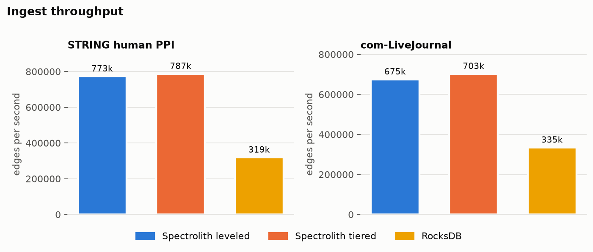
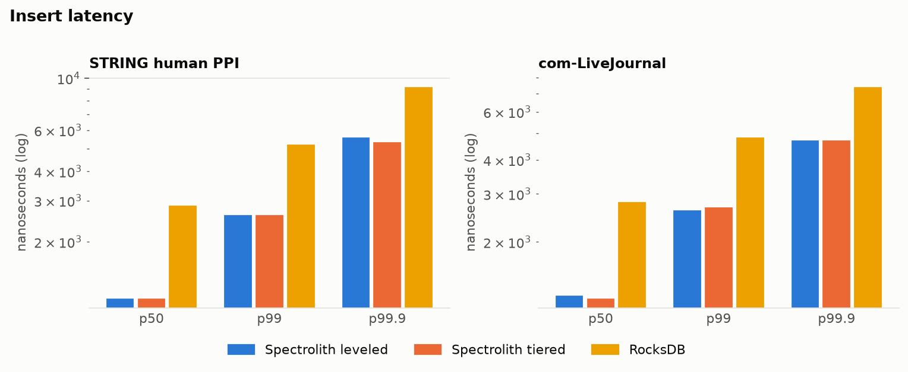
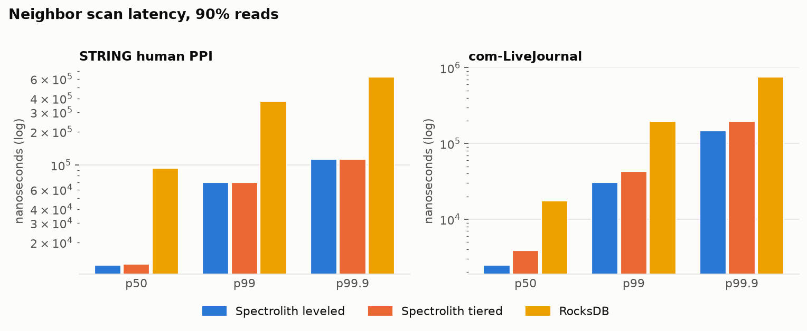
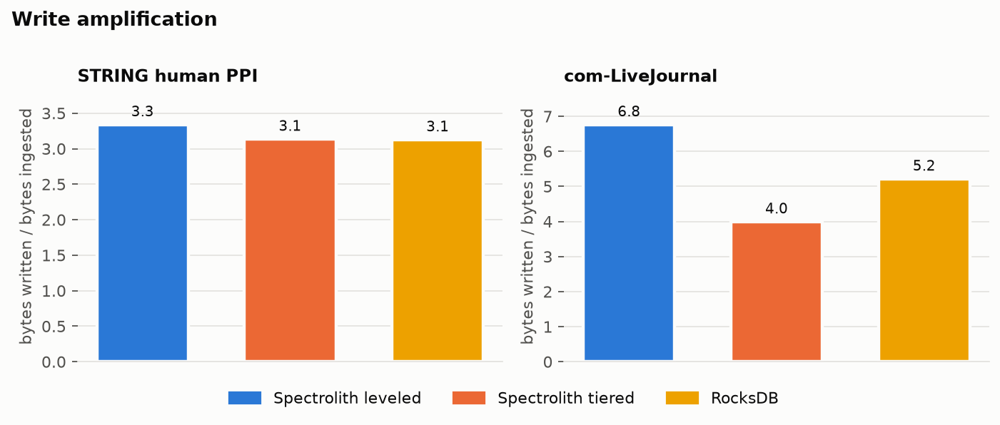
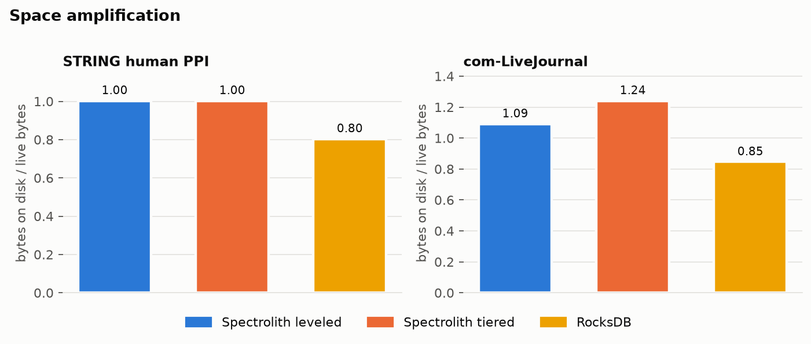
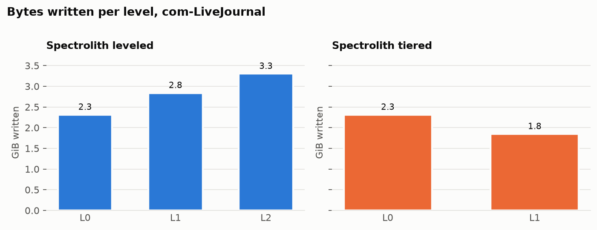
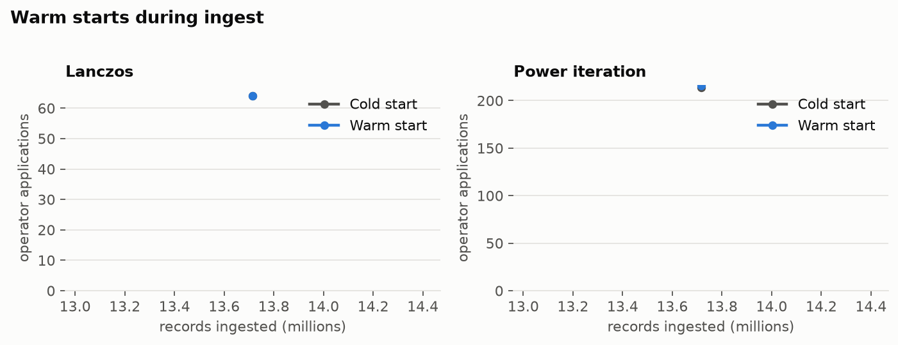

# Benchmark results

Generated by `scripts/run_benchmarks.sh`; do not edit by hand. See [BENCHMARKS.md](../BENCHMARKS.md) for the method and what the numbers mean.

```text
date: 2026-11-06T03:36:07Z
commit: f336750 + uncommitted changes
zig: 0.17.0
rocksdb: 11.13.2
cpu: Apple M4, 10 threads
memory_gib: 16
os: Darwin 25.6.0
reps: 3
```

## Bulk ingest

One edge per write, both directions, no fsync per write. Cells are the median, with the range across repetitions when there are several.





| graph | engine | edges/s | p50 | p99 | p99.9 | max | stalled | settle |
| --- | --- | --- | --- | --- | --- | --- | --- | --- |
| ppi | Spectrolith leveled | 773,156 (758,300–795,957) | 1.15 µs | 2.62 µs | 5.63 µs | 28.4 ms | 0.00 s | 0.4 s |
| ppi | Spectrolith tiered | 787,116 (770,061–791,616) | 1.15 µs | 2.62 µs | 5.38 µs | 28.1 ms | 0.00 s | 0.4 s |
| ppi | Leveled, no bloom | 782,265 (751,346–787,404) | 1.15 µs | 2.56 µs | 4.86 µs | 30.1 ms | 0.00 s | 0.4 s |
| ppi | RocksDB | 319,333 (319,252–340,498) | 2.88 µs | 5.25 µs | 9.22 µs | 6.32 ms | 0.00 s | 0.6 s |
| lj | Spectrolith leveled | 675,087 | 1.28 µs | 2.62 µs | 4.74 µs | 67.2 ms | 0.00 s | 7.4 s |
| lj | Spectrolith tiered | 702,723 | 1.25 µs | 2.69 µs | 4.74 µs | 120 ms | 0.00 s | 1.0 s |
| lj | Leveled, no bloom | 667,469 | 1.28 µs | 2.62 µs | 4.22 µs | 65.4 ms | 0.00 s | 7.3 s |
| lj | RocksDB | 334,574 | 2.82 µs | 4.86 µs | 7.42 µs | 10.5 ms | 0.00 s | 4.6 s |

## Mixed reads and writes



| graph | engine | read/write | ops/s | scan p50 | scan p99 | write p99 |
| --- | --- | --- | --- | --- | --- | --- |
| ppi | Spectrolith leveled | 90/10 | 61,956 (61,358–62,073) | 12.5 µs | 69.6 µs | 5.5 µs |
| ppi | Spectrolith leveled | 50/50 | 132,540 (131,706–133,059) | 11 µs | 49.2 µs | 2.37 µs |
| ppi | Spectrolith tiered | 90/10 | 61,965 (61,427–62,149) | 12.8 µs | 69.6 µs | 6.14 µs |
| ppi | Spectrolith tiered | 50/50 | 132,531 (131,984–133,108) | 10.8 µs | 49.2 µs | 2.62 µs |
| ppi | Leveled, no bloom | 90/10 | 61,866 (60,757–61,962) | 12.5 µs | 69.6 µs | 5.63 µs |
| ppi | Leveled, no bloom | 50/50 | 132,054 (127,927–132,591) | 11 µs | 49.2 µs | 2.82 µs |
| ppi | RocksDB | 90/10 | 9,685 (9,310–9,740) | 94.2 µs | 377 µs | 10.8 µs |
| ppi | RocksDB | 50/50 | 16,716 (16,586–16,755) | 96.3 µs | 377 µs | 8.19 µs |
| lj | Spectrolith leveled | 90/10 | 224,801 | 2.5 µs | 30.7 µs | 5.25 µs |
| lj | Spectrolith leveled | 50/50 | 355,015 | 2.37 µs | 22.5 µs | 2.37 µs |
| lj | Spectrolith tiered | 90/10 | 164,910 | 3.9 µs | 43 µs | 4.99 µs |
| lj | Spectrolith tiered | 50/50 | 258,881 | 3.9 µs | 39.9 µs | 2.37 µs |
| lj | Leveled, no bloom | 90/10 | 237,811 | 2.43 µs | 28.2 µs | 3.78 µs |
| lj | Leveled, no bloom | 50/50 | 354,998 | 2.3 µs | 22.5 µs | 2.37 µs |
| lj | RocksDB | 90/10 | 33,505 | 17.4 µs | 197 µs | 9.47 µs |
| lj | RocksDB | 50/50 | 52,797 | 16.9 µs | 193 µs | 7.42 µs |

## Amplification







| graph | engine | write amp | space amp | runs per scan | on disk |
| --- | --- | --- | --- | --- | --- |
| ppi | Spectrolith leveled | 3.34 | 1.00 | 2.50 | 0.31 GiB |
| ppi | Spectrolith tiered | 3.14 | 1.00 | 2.52 | 0.31 GiB |
| ppi | Leveled, no bloom | 3.34 | 1.00 | 2.50 | 0.31 GiB |
| ppi | RocksDB | 3.13 | 0.80 | n/a | 0.25 GiB |
| lj | Spectrolith leveled | 6.77 | 1.09 | 4.05 | 1.69 GiB |
| lj | Spectrolith tiered | 4.00 | 1.24 | 7.14 | 1.92 GiB |
| lj | Leveled, no bloom | 6.72 | 1.09 | 4.01 | 1.68 GiB |
| lj | RocksDB | 5.22 | 0.85 | n/a | 1.31 GiB |

Per level, first repetition:

| graph | engine | level | files | GiB now | runs into it | GiB written | write amp |
| --- | --- | --- | --- | --- | --- | --- | --- |
| ppi | Spectrolith leveled | L0 | 1 | 0.06 | 5 | 0.31 | 0.77 |
| ppi | Spectrolith leveled | L1 | 3 | 0.19 | 1 | 0.25 | 0.99 |
| ppi | Spectrolith leveled | L2 | 1 | 0.06 | 1 | 0.06 | 1.00 |
| ppi | Spectrolith tiered | L0 | 1 | 0.06 | 5 | 0.31 | 0.77 |
| ppi | Spectrolith tiered | L1 | 1 | 0.25 | 1 | 0.25 | 0.99 |
| lj | Spectrolith leveled | L0 | 1 | 0.08 | 25 | 2.31 | 1.14 |
| lj | Spectrolith leveled | L1 | 3 | 0.22 | 6 | 2.84 | 1.27 |
| lj | Spectrolith leveled | L2 | 21 | 1.40 | 21 | 3.30 | 2.21 |
| lj | Spectrolith tiered | L0 | 1 | 0.08 | 25 | 2.31 | 1.14 |
| lj | Spectrolith tiered | L1 | 6 | 1.85 | 6 | 1.85 | 0.83 |

## Durable writes (fsync on every write)

| graph | engine | edges/s | p50 | p99 |
| --- | --- | --- | --- | --- |
| ppi | Spectrolith leveled | 257 | 3.93 ms | 4.98 ms |
| ppi | RocksDB | 258 | 3.93 ms | 4.13 ms |
| lj | Spectrolith leveled | 257 | 3.93 ms | 4.19 ms |
| lj | RocksDB | 257 | 3.93 ms | 4.13 ms |

## Spectral costs

A snapshot with 99% of the edges compacted and 1% in the MemGraph.

| graph | vertices | edges in view | delta entries | build view | build delta | SpMV | SpMV with delta | M edges/s |
| --- | --- | --- | --- | --- | --- | --- | --- | --- |
| ppi | 19,622 | 13,578,250 | 137,154 | 466 ms | 19 ms | 8.5 ms | 8.8 ms | 1,604 |
| lj | 3,990,058 | 68,668,756 | 693,622 | 10,095 ms | 322 ms | 72.4 ms | 74.1 ms | 948 |

## Analytics during ingest



| round | records | lambda2 | view | delta | Lanczos cold | warm | power cold | warm | behind by |
| --- | --- | --- | --- | --- | --- | --- | --- | --- | --- |
| 0 | 2,403,898 | 0.32450 | 0 ms | 352 ms | 64 / 895 ms | 64 / 871 ms | 1522 / 12,002 ms | 1522 / 11,936 ms | 11,311,506 |
| 1 | 13,715,404 | 0.33158 | 374 ms | 295 ms | 64 / 1,318 ms | 64 / 1,325 ms | 214 / 3,523 ms | 216 / 3,556 ms | 0 |

Iterations are operator applications. `*` means power iteration hit its cap of 3000 without converging. `behind by` is how many sequence numbers ingest moved during the round's solves.

## Vector kernels

| kernel | plain loop GB/s | `@Vector(4, f64)` GB/s | speedup |
| --- | --- | --- | --- |
| dot | 12.9 | 45.9 | 3.6x |
| distsq | 12.4 | 40.5 | 3.3x |
| axpy | 26.6 | 44.8 | 1.7x |
